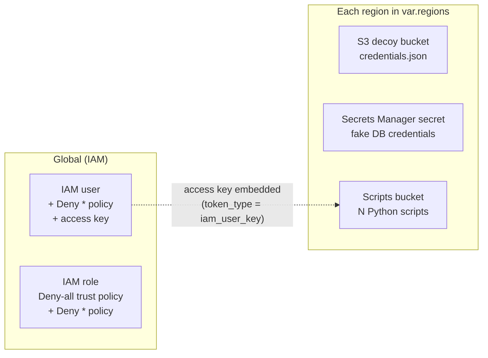
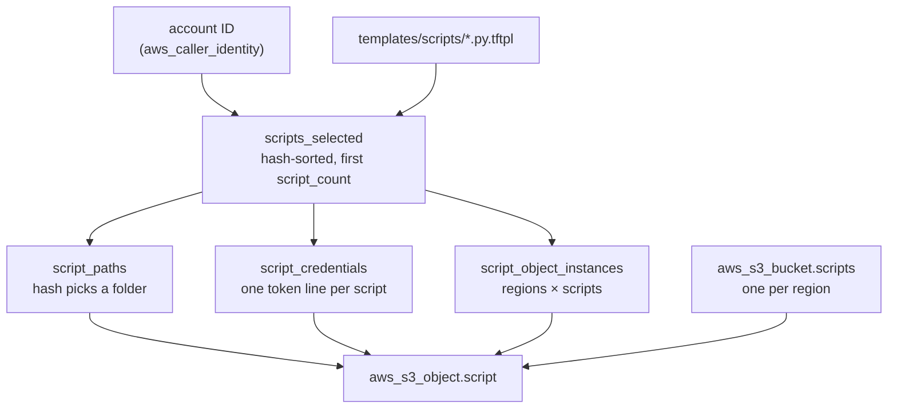

# Architecture

This document explains what `terraform-aws-deception` deploys into a client AWS account and how the module is put together. For inputs, outputs and usage, see the [README](../README.md).

## Purpose

The module plants **decoys**: AWS resources that look valuable but have no real use. No legitimate workload ever touches them.

## What gets deployed

| Kind | Variable | Scope | Created resources |
|---|---|---|---|
| IAM user | `iam_user` | Global, `count` users | `aws_iam_user`, `aws_iam_user_policy` (`Deny *`), `aws_iam_access_key` |
| IAM role | `iam_role` | Global, `count` roles | `aws_iam_role` (deny-all trust policy), `aws_iam_role_policy` (`Deny *`) |
| S3 decoy | `s3_bucket` | `count` × each region | `aws_s3_bucket`, public access block, SSE-S3, `aws_s3_object` `credentials.json` |
| Secret | `secret` | `count` × each region | `aws_secretsmanager_secret` + version holding fake DB credentials |
| Decoy scripts | `decoy_scripts` | 1 bucket per region | `aws_s3_bucket`, public access block, SSE-S3, one `aws_s3_object` per selected script |

Each kind is off by default (`enabled = false`). When enabled, every resource gets `local.common_tags`, which is `lure_tags` plus the tracking tag.

### Resource names

| Kind | Name pattern | Example |
|---|---|---|
| IAM user / role | `<name_prefix>-<8 hex>` | `svc-admin-1f0c9a7e` |
| S3 decoy bucket | `<name_prefix>-<8 hex>` | `legacy-backups-5b2e81d0` |
| Secret | `<name_prefix>-<8 hex>` | `prod-db-credentials-c47a1e93` |
| Scripts bucket | `<name_prefix>-<4 hex>-<region>` | `devops-scripts-a3f9-us-east-1` |

The hex suffixes come from `random_id`. They keep names unique (S3 bucket names are global across all AWS accounts) without adding anything that identifies the vendor.

## How it works

### File layout

| File | Responsibility |
|---|---|
| `main.tf` | Terraform and provider version requirements |
| `variables.tf` | Input contract and validation |
| `locals.tf` | Common tags and the per-kind instance maps |
| `iam.tf` | IAM users, access keys, roles and their deny policies |
| `s3_decoys.tf` | S3 decoy buckets and `credentials.json` |
| `secrets.tf` | Secrets Manager decoys |
| `decoy_scripts.tf` | Which scripts are planted, where, and with which token |
| `s3_decoy_scripts.tf` | Scripts buckets and script objects |
| `templates/scripts/*.py.tftpl` | Python script templates; each contains a `${credentials}` placeholder |
| `outputs.tf` | ARNs, script paths and the tracking tag for the platform |

### Instance maps and `for_each`

Every resource is created with `for_each` over a map built in `locals.tf` or `decoy_scripts.tf`. The map key becomes part of the resource's address in state, so keys must stay the same between runs.

| Map | Built from | Example keys |
|---|---|---|
| `iam_user_instances`, `iam_role_instances` | `range(count)` | `"0"`, `"1"` |
| `s3_instances`, `secret_instances` | `setproduct(regions, range(count))` | `"us-east-1-0"`, `"eu-west-1-0"` |
| `script_object_instances` | `setproduct(regions, scripts_selected)` | `"us-east-1::deploy_release.py.tftpl"` |

When a kind is disabled, its map is empty and Terraform creates nothing for it.

### Multi-region

Regional resources set the per-resource `region` argument, which needs AWS provider 6.0 or newer. One module call therefore deploys into every entry of `var.regions`, whatever region the provider is set to. The provider's region only matters for IAM, which is global. `var.regions` rejects duplicates because they would produce duplicate map keys.

### Decoy scripts

This is the most involved kind. The goal is a bucket that looks like a team's collection of DevOps scripts, where each script has a credential "accidentally" pasted into it.

**1. Selection.** Each template filename is hashed with `md5(account_id-name_prefix-filename)`. The files are sorted by hash and the first `script_count` are kept. This acts as a shuffle that differs between accounts but gives the same result on every run in one account.

> `random_shuffle` can't be used here. Its output isn't known until apply, and `for_each` keys must be known at plan time. Hashing values that are known at plan time is the standard workaround.

**2. Placement.** A second hash of `account_id-filename` picks one of five folders: the bucket root, `ci/`, `tools/`, `scripts/deploy/` or `internal/jobs/`. `.tftpl` is removed from the name, giving keys like `internal/jobs/deploy_release.py`. Every regional bucket has the same scripts at the same paths.

**3. Credential.** `templatefile()` replaces the template's `${credentials}` placeholder with one or more Python assignment lines, chosen by `token_type`:

| `token_type` | Line(s) written | Source |
|---|---|---|
| `gitlab` | `GITLAB_TOKEN = "glpat-<20 chars>"` | `random_string.script_token` |
| `aws` | `AWS_ACCESS_KEY_ID = "AKIA<16 chars>"` + `AWS_SECRET_ACCESS_KEY = "<40 chars>"` | `random_string.script_token` + `random_password.script_secret` |
| `iam_user_key` | Real access key ID and secret of a module IAM user | `aws_iam_access_key.decoy`, users assigned round-robin |

`script_credentials` builds all three options for every script and then picks one with `[var.decoy_scripts.token_type]`. Only the resources for the chosen type exist, so each option is wrapped in `try(..., "")` to avoid errors from referring to the others.

**4. Safety check.** `iam_user_key` needs at least one IAM user. A `lifecycle.precondition` on `aws_s3_object.script` enforces this and fails the plan with a clear message. It's a precondition rather than a variable validation because it compares two variables, and cross-variable validation needs Terraform 1.9.

## Detection

The module creates the decoys; the Cyngular platform does the detecting. A touch shows up in the client's CloudTrail as follows:

| Decoy | What the attacker does | CloudTrail event |
|---|---|---|
| IAM user / role | Lists or reads them; uses the access key | IAM management events; calls signed with the key show as `AccessDenied` with the user's ARN and access key ID |
| IAM role | Tries to assume it | `AssumeRole` denied |
| Secret | Reads the value | `GetSecretValue` (management event, logged by default) |
| S3 decoy / scripts | Lists buckets; reads objects | `ListBuckets` is logged by default. **`GetObject` is a data event and is only logged if the client has S3 data events turned on.** |

The platform links an event to a client using the resource ARN (from `iam_user_arns`, `s3_bucket_arns`, `secret_arns`, `decoy_scripts_bucket_arns`) and the tracking tag.

## Lifecycle

- **Destroy is clean.** Buckets use `force_destroy = true`, so objects an attacker uploaded don't block removal. Secrets use `recovery_window_in_days = 0`, so they're deleted immediately and the name can be reused right away.
- **Some changes replace resources.** The scripts bucket suffix has `name_prefix` and the account ID as `keepers`. Changing either generates a new suffix, which renames and replaces every scripts bucket. Changing a kind's `name_prefix` also replaces those resources, because the name is part of the resource.
- **State holds secrets.** IAM access key secrets, the generated passwords and tokens, and the script contents (including the real key when `token_type = iam_user_key`) are all in Terraform state. Protect the state backend accordingly.
